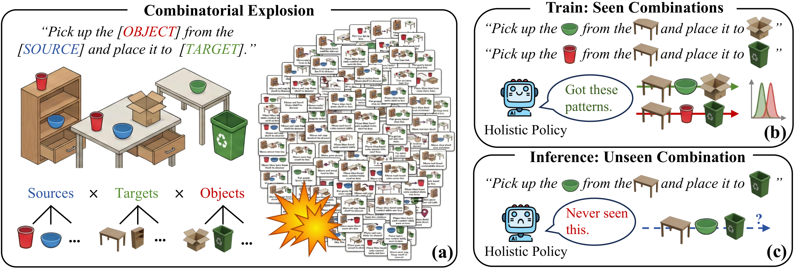
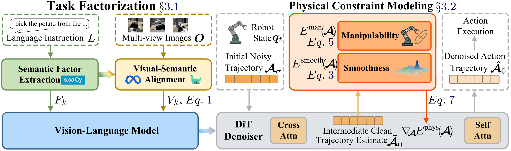

# Official Implementation of Compositional Diffusion Policy for Vision-Language-Action Agents

## Abstract

Vision-Language-Action (VLA) agents face a combinatorial task space where semantic and physical requirements are recombined in novel ways. However, existing holistic policies typically entangle them in a single latent representation, limiting generalization to unseen compositions and compromising physical feasibility. To this end, this work proposes an energy-based compositional diffusion policy that models robot action trajectory generation with distinct semantic and physical energy terms. Specifically, the agent factorizes multimodal inputs into grounded semantic factors and models them as implicit semantic energies. In parallel, it formulates physical constraints, including motion smoothness and kinematic manipulability, as explicit differentiable energies. These energies are jointly combined to guide trajectory generation toward both task satisfaction and physical feasibility. Our agent shows consistent improvements in compositional generalization and physical validity in real-world experiments and across some public benchmarks. Comprehensive ablation studies further validate the effectiveness of each component.



## Method



## Model Resources

Prepare the following models and language resources using their official links.

| Resource | Links |
| --- | --- |
| Qwen2.5-VL | [GitHub](https://github.com/QwenLM/Qwen2.5-VL) · [Weights](https://huggingface.co/Qwen/Qwen2.5-VL-3B-Instruct) |
| GroundingDINO | [GitHub](https://github.com/IDEA-Research/GroundingDINO) · [Transformers weights](https://huggingface.co/IDEA-Research/grounding-dino-tiny) |
| SAM2.1 Hiera Large | [GitHub and checkpoints](https://github.com/facebookresearch/sam2) |
| spaCy `en_core_web_sm` 3.7.1 | [GitHub release](https://github.com/explosion/spacy-models/releases/tag/en_core_web_sm-3.7.1) |
| WordNet | [NLTK data](https://www.nltk.org/data.html) |

## Installation

```bash
git clone https://github.com/WhyxyxIsNotAnAvailableName/cdp.git
cd cdp
```

### Training environment

```bash
conda create -n cdp-train python=3.10 -y
conda activate cdp-train
pip install -r requirements.txt
```

### Preprocessing environment

```bash
conda create -n cdp-preprocess python=3.10 -y
conda activate cdp-preprocess
pip install -r requirements-preprocess.txt
```

## Data and Configuration

Download the [RoboCasa kitchen datasets](https://robocasa.ai/docs/build/html/datasets/using_datasets.html). List each LeRobot dataset directory relative to `data_root_dir` in [configs/train.yaml](configs/train.yaml), then fill in your model paths and a positive `action_horizon`.

```yaml
run_root_dir: path/to/training_outputs

framework:
  qwenvl:
    base_vlm: path/to/vlm_model
  action_model:
    action_horizon: null

datasets:
  vla_data:
    data_root_dir: path/to/robocasa
    datasets:
      - name: path/to/task/lerobot
        weight: 1.0
    keys: [robot0_agentview_left, robot0_agentview_right, robot0_eye_in_hand]
    action_keys: [end_effector_position, end_effector_rotation, gripper_close, base_motion, control_mode]
    state_keys: []
    language_key: human.task_description
    semantic_sidecar_root: path/to/semantic_masks

perception:
  grounding_model: path/to/grounding_dino_model
  sam_checkpoint: path/to/sam2_checkpoint.pt
```

`keys`, `action_keys`, `state_keys`, and `language_key` select fields from `meta/modality.json`. The action dimension is inferred from the selected action fields. Training and preprocessing use the same dataset list.

## Preprocessing

```bash
conda activate cdp-preprocess
GROUNDING_GPUS=0 bash scripts/preprocess.sh
```

Semantic factors and masks are saved under `semantic_sidecar_root/masks/<dataset_name>/episode_<index>/`.

## Training

```bash
conda activate cdp-train
NUM_PROCESSES=4 bash scripts/train.sh
```

Checkpoints are saved under `<run_root_dir>/<run_id>/checkpoints/`.

## Citation

```bibtex
@inproceedings{xu2026cdp,
  title     = {Compositional Diffusion Policy for {Vision-Language-Action} Agents},
  author    = {Xu, Yuxuan and Gao, Jianzhe and Kong, Hanlin and Yin, Zhen and Ling, Yonggen and Wang, Wenguan},
  booktitle = {Conference on Robot Learning (CoRL)},
  year      = {2026}
}
```
